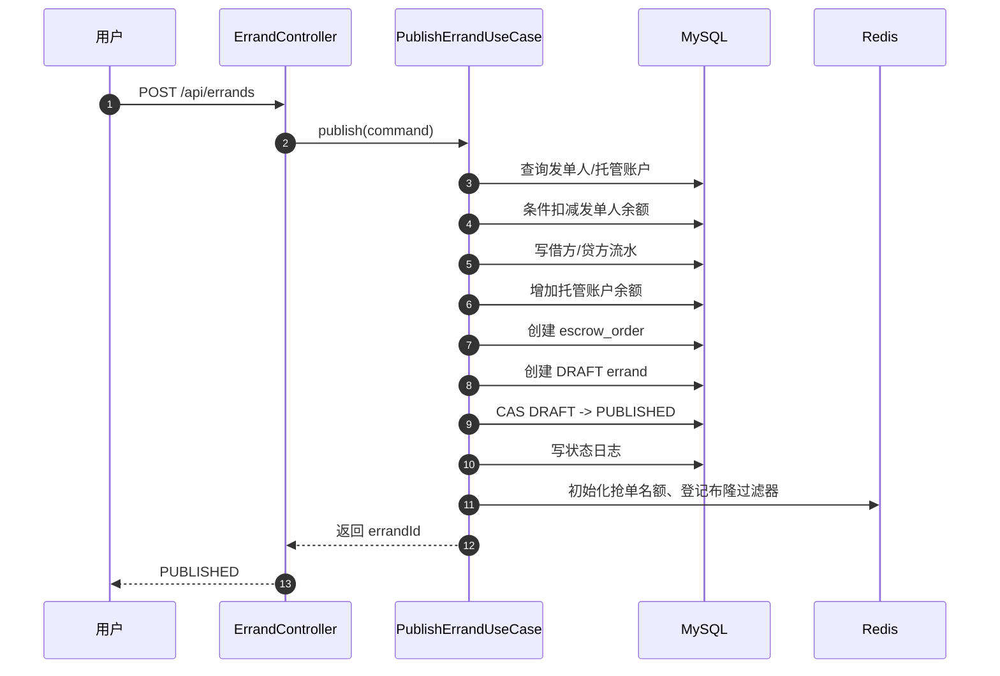
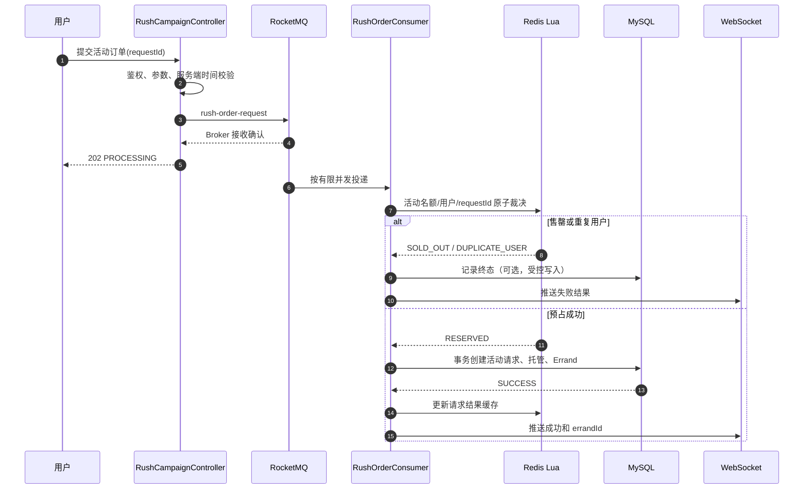

# P9：限时活动下单与 RocketMQ 削峰设计

> 文档日期：2026-09-10  
> 文档状态：方案设计稿，尚未进入编码  
> 目标：在 CampusDash 中增加一个自然、可压测、可证明正确性的 RocketMQ 削峰场景，同时复用现有的 Redis Lua、MySQL CAS、资金托管、任务状态机和 Worker 体系。

---

## 1. 这次准备做什么

为项目增加“限时跑腿活动”功能。

推荐的业务场景如下：

```text
11:30 校园午餐代购活动开放
3000 名学生在短时间内同时提交下单请求
平台当前只提供 500 个配送服务名额
每名学生在同一活动中最多成功下单一次
成功请求异步生成一张可供跑腿员抢单的 Errand
跑腿员可以承接多张订单，但进行中订单不能超过容量上限
```

也可以将活动文案替换成：

```text
09:00 联名商品限时代购活动开放
平台提供 500 个“代购服务名额”
3000 名学生同时参与
```

这里必须明确：CampusDash 是跑腿平台，不是商品销售平台。除非后续增加完整商品库存域，否则系统能保证的是“平台代购服务名额不超卖”，不能保证第三方商家的真实商品库存。

### 1.1 为什么选这个场景

当前普通发布任务是同步完成的。每次发布会执行扣款、复式记账、创建托管单、创建任务、状态流转和 Redis 名额初始化等操作。大量用户在同一秒发布时，会形成明显的数据库突发写入。

限时活动具备引入 MQ 削峰的真实理由：

- 请求在固定时间集中爆发；
- 经过活动名额裁决后，仍有数百个有效订单需要落库；
- 每张有效订单都涉及多次资金和任务写入；
- 用户可以接受短暂的 `PROCESSING` 状态；
- 消费者可以按照数据库安全吞吐持续处理；
- 可以用压测数据比较同步和异步方案的差异。

### 1.2 这次不准备做什么

第一版暂不实现：

- 商家真实商品库存同步；
- 多 SKU、多商家购物车；
- 动态路线规划；
- 自动拼单和智能批次分配；
- 精确到毫秒的绝对先到先得；
- 用户可见的实时排队名次；
- 根据在线跑腿员实时动态计算活动配额；
- 将所有普通任务发布都改成异步。

普通 `/api/errands` 发布接口继续保留同步语义，只有新的限时活动入口采用 MQ 异步创建。

---

## 2. 今天讨论形成的核心结论

### 2.1 四种技术分别解决什么问题

```text
Redis Lua：高性能、原子地完成活动名额与幂等裁决
RocketMQ：承接瞬时请求，把数据库写入摊平到一段时间内
MySQL CAS：在数据库中完成最终状态和数量裁决
唯一索引/CHECK：即使代码或缓存出错，也守住最终不变式
```

这不是所谓“三层架构”，而是多道并发安全防线。

### 2.2 MQ 削峰不会减少总工作量

假设 500 个成功活动订单，每个订单最终要执行多次数据库写入：

```text
没有 MQ：这些写操作集中在一两秒内发生
使用 MQ：这些写操作由有限数量消费者在几十秒内完成
```

MQ 做的是“削平峰值”，不是“消灭写入”。如果消费者无限扩容，仍然会重新把数据库打满。

### 2.3 活动下单和跑腿抢单是两条不同链路

```text
活动下单：3000 个用户创建不同订单
核心问题：数据库瞬时写入过大
主要方案：RocketMQ 削峰 + 活动 Lua + 数据库最终约束

跑腿抢单：多个跑腿员争抢同一张 Errand
核心问题：一张订单不能同时分配给两个人
主要方案：Redis Lua + MySQL CAS + grab_record 唯一索引
```

不要使用 MQ 来替代同一任务的最终抢单裁决。当前同步抢单可以直接给出最终结果，而且 Lua 后通常只有一个有效数据库写请求。

### 2.4 两种“一人一单”不能混淆

```text
下单用户：同一活动最多成功下一单
订单：同一时刻只能有一个有效跑腿员
跑腿员：可以承接多单，但不能超过并发容量 K
```

活动的 500 个名额表示 500 张配送服务订单，不表示必须由 500 名不同跑腿员完成。

更合理的例子是：

```text
100 名跑腿员 × 每人最多 5 个进行中订单 = 500 个服务容量
```

同一路线、同一食堂的跑腿员一次承接多单符合现实业务。强制跑腿员一人一单会降低配送效率。

---

## 3. 当前同步发布流程

当前入口是：

```text
POST /api/errands
```

核心实现：`dash-application/.../PublishErrandUseCase.java`。

### 3.1 当前时序



### 3.2 同步模式语义

接口返回成功意味着：

- 钱已经完成托管；
- 任务已经写入数据库；
- 任务已经进入 `PUBLISHED`；
- Redis 抢单名额已经初始化；
- 用户拿到的是最终结果，不是受理结果。

### 3.3 同步模式优点

- 调用链短，容易理解；
- 失败可以直接同步返回；
- 数据库本地事务边界明确；
- 前端不需要处理中页面；
- 不需要消费重试、结果查询和补偿任务。

### 3.4 同步模式在活动峰值下的问题

- 3000 个 HTTP 请求同时占用在线线程；
- 大量请求等待 Hikari 数据库连接；
- 多个资金事务同时竞争钱包和系统托管账户；
- 数据库日志、索引和事务提交在同一时间出现尖峰；
- HTTP 超时不代表事务一定失败，客户端重试会增加幂等压力；
- 在线接口的 P95/P99 延迟容易明显升高。

---

## 4. 目标异步创建流程

建议增加独立入口：

```text
POST /api/rush-campaigns/{campaignId}/orders
```

普通任务仍同步发布；限时活动订单采用异步受理。

### 4.1 推荐的第一版：MQ 先排队，消费者再执行 Lua



### 4.2 为什么第一版推荐 MQ 在 Lua 前面

如果先 Lua、后发普通 MQ：

```text
Lua 已扣名额
→ 应用在 MQ 发送前宕机
→ 名额被占用，但消费者永远收不到消息
```

MQ 先接收请求后，消费者中的 Lua 和数据库操作即使中途失败，RocketMQ 仍然可以重新投递同一消息。Lua必须识别“同一 requestId 已预占但尚未完成”，让重试继续落库。

第一版的代价是：所有参与者最初都会看到 `PROCESSING`，售罄结果需要等待消费者处理后才能确认。

### 4.3 后续可选：Lua 先裁决，再进入 MQ

如果产品要求立即告诉 2500 名失败用户“已售罄”，可以改成：

```text
API
→ Lua 立即裁决
→ 仅 500 个 RESERVED 请求进入 RocketMQ
→ 消费者异步落库
```

但必须解决 Redis 与 RocketMQ 双写一致性，可以选择：

1. RocketMQ 事务消息：先发半消息，Lua作为本地操作，事务回查读取 Redis 预占状态；
2. Lua 同时 `XADD` Redis Stream，再由 Relay 转发到 RocketMQ；
3. Redis 预占记录 + 发送重试 + 长时间 PENDING 扫描补偿；
4. 数据库保存最小请求/Outbox，再异步执行重业务写入。

第一版不建议直接使用不带补偿的 `luaReserve(); mq.send();`。

---

## 5. 业务规则和必须守住的不变式

设计并发方案前，先定义什么叫“正确”。

### 5.1 活动侧不变式

| 编号 | 不变式 | 数据库最终防线 |
|---|---|---|
| RUSH-1 | 成功订单数不能超过活动名额 | `sold_count < quota_total` 条件 CAS |
| RUSH-2 | 同一用户在同一活动最多成功一次 | `UNIQUE(campaign_id, user_id)` |
| RUSH-3 | 同一 requestId 最多生成一张任务 | `UNIQUE(request_id)`、Errand 来源唯一索引 |
| RUSH-4 | 只有活动窗口内被服务端受理的请求有效 | 服务端 `acceptedAt` + 活动时间校验 |
| RUSH-5 | 每个成功请求必须对应一张托管单和一张 Errand | 关联唯一索引 + 对账 |
| RUSH-6 | 失败请求不能永久占用 Redis 活动名额 | 幂等补偿 Lua + 扫描任务 |

### 5.2 资金侧不变式

| 编号 | 不变式 |
|---|---|
| FUND-1 | 用户余额不能为负 |
| FUND-2 | 同一活动请求只能扣款一次 |
| FUND-3 | 借方总额等于贷方总额 |
| FUND-4 | 一张 Errand 最多对应一张 HELD 托管单 |
| FUND-5 | 订单创建失败时不能留下不可追溯的资金中间态 |

### 5.3 跑腿侧不变式

| 编号 | 不变式 |
|---|---|
| RUNNER-1 | 一张单名额为 1 的 Errand 同一轮最多一个抢中者 |
| RUNNER-2 | 同一跑腿员不能重复占用同一订单 |
| RUNNER-3 | 跑腿员的进行中订单数不能超过容量 K |
| RUNNER-4 | 超时流转时旧跑腿员容量释放、新跑腿员容量占用必须一致 |
| RUNNER-5 | 结算、退款、取消等终态必须幂等释放容量 |

---

## 6. 活动数据模型草案

以下 SQL 是设计草案，编码时需要结合现有 `init.sql` 命名和分片键进一步校准。

### 6.1 活动表 `rush_campaign`

```sql
CREATE TABLE rush_campaign (
  id             BIGINT       NOT NULL,
  campus_id      BIGINT       NOT NULL,
  name           VARCHAR(128) NOT NULL,
  start_at       DATETIME(3)  NOT NULL,
  end_at         DATETIME(3)  NOT NULL,
  quota_total    INT          NOT NULL,
  sold_count     INT          NOT NULL DEFAULT 0,
  status         VARCHAR(16)  NOT NULL,
  version        BIGINT       NOT NULL DEFAULT 0,
  created_at     DATETIME(3)  NOT NULL DEFAULT CURRENT_TIMESTAMP(3),
  updated_at     DATETIME(3)  NOT NULL DEFAULT CURRENT_TIMESTAMP(3)
                                ON UPDATE CURRENT_TIMESTAMP(3),
  PRIMARY KEY (id),
  KEY idx_campus_time (campus_id, status, start_at),
  CONSTRAINT ck_rush_quota
    CHECK (sold_count >= 0 AND sold_count <= quota_total)
);
```

最终活动名额 CAS：

```sql
UPDATE rush_campaign
   SET sold_count = sold_count + 1,
       version = version + 1
 WHERE id = ?
   AND status = 'ACTIVE'
   AND sold_count < quota_total
   AND version = ?;
```

如果高并发下不想预读版本，也可只使用 `sold_count < quota_total` 作为原子条件。是否携带 `version` 需要压测比较冲突重试成本。

### 6.2 活动请求表 `rush_request`

```sql
CREATE TABLE rush_request (
  request_id     VARCHAR(64)  NOT NULL,
  campaign_id    BIGINT       NOT NULL,
  campus_id      BIGINT       NOT NULL,
  user_id        BIGINT       NOT NULL,
  status         VARCHAR(24)  NOT NULL,
  errand_id      BIGINT       NULL,
  error_code     VARCHAR(48)  NULL,
  accepted_at    DATETIME(3)  NOT NULL,
  created_at     DATETIME(3)  NOT NULL DEFAULT CURRENT_TIMESTAMP(3),
  updated_at     DATETIME(3)  NOT NULL DEFAULT CURRENT_TIMESTAMP(3)
                                ON UPDATE CURRENT_TIMESTAMP(3),
  PRIMARY KEY (request_id),
  UNIQUE KEY uk_campaign_user (campaign_id, user_id),
  UNIQUE KEY uk_errand (errand_id),
  KEY idx_user_time (user_id, created_at),
  KEY idx_status_time (status, updated_at)
);
```

第一版建议定义为“每个用户每个活动只有一次参与机会”。因此即使余额不足失败，也不能换新 requestId 反复参与。若未来允许业务失败后重新参与，需要重新设计唯一性语义，不能简单删除索引。

### 6.3 Errand 来源字段

可考虑为 `errand` 增加：

```sql
source_type       VARCHAR(24) NULL,
source_request_id VARCHAR(64) NULL,
UNIQUE KEY uk_source_request (source_request_id)
```

作用：MQ消息即使重复消费，数据库也不能生成第二张活动任务。

### 6.4 跑腿容量表 `runner_workload`

```sql
CREATE TABLE runner_workload (
  runner_id      BIGINT      NOT NULL,
  ongoing_count  INT         NOT NULL DEFAULT 0,
  max_ongoing    INT         NOT NULL DEFAULT 5,
  version        BIGINT      NOT NULL DEFAULT 0,
  updated_at     DATETIME(3) NOT NULL DEFAULT CURRENT_TIMESTAMP(3)
                               ON UPDATE CURRENT_TIMESTAMP(3),
  PRIMARY KEY (runner_id),
  CONSTRAINT ck_runner_workload
    CHECK (ongoing_count >= 0 AND ongoing_count <= max_ongoing)
);
```

占用容量：

```sql
UPDATE runner_workload
   SET ongoing_count = ongoing_count + 1,
       version = version + 1
 WHERE runner_id = ?
   AND ongoing_count < max_ongoing;
```

释放容量也必须带业务幂等约束。更稳妥的做法是增加容量流水/分配记录，以 `errand_id + round + action` 作为唯一业务号，避免重复消息把容量减成负数。

---

## 7. Redis Key 和 Lua 设计

### 7.1 建议 Key

```text
rush:campaign:{campaignId}:stock
    活动剩余服务名额

rush:campaign:{campaignId}:users
    Hash 或 Set，记录已预占用户
    如果需要识别同请求重试，建议 Hash: userId -> requestId

rush:request:{requestId}
    请求状态和归属信息
    userId、campaignId、status、reservedAt
```

所有 Key 应包含相同 hash tag（如使用 Redis Cluster）：

```text
rush:{campaignId}:stock
rush:{campaignId}:users
rush:{campaignId}:request:{requestId}
```

这样 Lua 涉及的 Key 会落到同一 Redis Slot。

### 7.2 预占 Lua 必须原子完成

```text
1. 校验活动是否允许处理
2. 检查 requestId 当前状态
3. 检查 userId 是否已参与
4. 检查 stock 是否大于 0
5. stock - 1
6. users[userId] = requestId
7. request 状态写为 RESERVED
8. 返回明确结果码
```

建议结果枚举：

```text
RESERVED                  首次预占成功
RESERVED_BY_SAME_REQUEST  同一消息重试，继续落库
DUPLICATE_USER            用户已通过另一个请求参与
SOLD_OUT                  活动名额不足
NOT_STARTED               未到开始时间
ENDED                     活动已经结束
INVALID_CAMPAIGN          Redis活动数据不存在
```

`RESERVED_BY_SAME_REQUEST` 是消费重试能否正确工作的关键。

### 7.3 补偿 Lua

补偿不能直接 `INCR stock`，必须先确认：

```text
users[userId] 当前保存的 requestId
== 本次准备补偿的 requestId
且 request 状态仍然是 RESERVED
```

只有匹配时才能：

```text
stock + 1
删除 userId 预占
request 状态改为 FAILED/ROLLED_BACK
```

补偿脚本重复执行必须没有副作用。

### 7.4 Redis 不是最终真相源

即使 Lua 已经保证剩余名额不小于 0，数据库仍必须执行：

- 活动数量条件更新；
- `campaign_id + user_id` 唯一约束；
- `request_id` 唯一约束；
- Errand来源唯一约束；
- 资金业务号唯一约束。

原则仍然是：

```text
Redis 保性能，MySQL 保最终正确。
```

---

## 8. RocketMQ 设计

### 8.1 新增 Topic

第一版使用普通消息 Topic：

```text
rush-order-request
```

建议消费组：

```text
dash-rush-order-consumer
```

该 Topic 的消息不需要延迟，也不是现有资金事件 Topic。不要和以下现有用途混用：

- `errand-confirm-timeout`：确认超时定时消息；
- `errand-auto-settle`：送达后自动结算定时消息；
- `errand-cache-evict`：缓存延迟双删；
- `errand-fund-event`：结算/退款事务事件。

### 8.2 消息体

```json
{
  "schemaVersion": 1,
  "requestId": "01J-RUSH-USER1001-001",
  "campaignId": "90001",
  "campusId": "1",
  "userId": "1001",
  "acceptedAt": "2026-09-10T11:30:00.123+08:00",
  "title": "帮我购买午餐活动套餐",
  "rewardCents": 1500
}
```

注意事项：

- ID 一律按字符串传输，避免 JavaScript 超过安全整数范围；
- `acceptedAt` 由服务端生成，不能信任客户端时间；
- 消息只携带完成业务所需的命令数据；
- 余额、信用分、活动当前库存等易变化数据由消费者重新读取；
- 消息 Key 使用 `requestId`，便于排查和幂等。

### 8.3 接口发送语义

只有 Broker 明确确认接收后，API 才返回 `202 PROCESSING`。

如果发送结果不确定：

- 客户端使用同一 `requestId` 重试；
- 重复消息是允许的；
- 消费者必须幂等；
- 不能因为担心重复就生成新的 requestId。

### 8.4 消费并发

消费者并发不能盲目增加。建议初始值设为 4～8，再通过压测校准，并保证 Worker 不占满全部 Hikari 连接。

需要同时观察：

- MQ积压数量；
- 最老消息等待时间；
- 数据库连接池活跃连接；
- 数据库写入延迟；
- 消费P95/P99；
- 消费失败和重试次数。

允许短时间积压是削峰系统的正常现象。目标不是“MQ永远没有积压”，而是“数据库稳定，并且积压能在业务SLA内消化”。

### 8.5 是否要求严格顺序

第一版建议不承诺毫秒级绝对先到先得。多个消费者并发处理时，最终 Redis Lua 执行顺序可能与客户端发起时间存在细微差异。

如果后续强制严格公平，可以考虑：

- 同一活动使用 FIFO Topic/MessageGroup；
- API分配单调递增受理序号；
- 单活动串行裁决、裁决后再并行落库。

但严格顺序会降低吞吐，应先明确业务是否真的需要。

---

## 9. 异步请求状态机和 API

### 9.1 请求状态

建议状态如下：

```text
QUEUED
  已被MQ受理，等待消费者

RESERVED
  Redis活动名额预占成功，准备数据库落库

SUCCESS
  数据库事务成功，Errand已创建

FAILED_SOLD_OUT
  活动名额不足

FAILED_DUPLICATE
  同一用户已经参与

FAILED_INSUFFICIENT_BALANCE
  资金不足，名额已补偿

FAILED_INVALID
  活动或请求不合法

DEAD
  超过最大重试次数，需要补偿/人工检查
```

### 9.2 提交接口

```http
POST /api/rush-campaigns/{campaignId}/orders
Idempotency-Key: <requestId>
```

响应：

```http
HTTP/1.1 202 Accepted
```

```json
{
  "code": "OK",
  "message": "请求已进入处理队列",
  "data": {
    "requestId": "01J-RUSH-USER1001-001",
    "status": "PROCESSING"
  }
}
```

### 9.3 查询接口

```http
GET /api/rush-requests/{requestId}
```

成功结果：

```json
{
  "requestId": "01J-RUSH-USER1001-001",
  "status": "SUCCESS",
  "errandId": "7312345678901234567"
}
```

失败结果：

```json
{
  "requestId": "01J-RUSH-USER1001-001",
  "status": "FAILED",
  "errorCode": "SOLD_OUT"
}
```

查询时必须校验当前用户是该 requestId 的所有者，不能允许任意用户遍历结果。

### 9.4 WebSocket事件

```json
{
  "type": "rush.order.result",
  "payload": {
    "requestId": "01J-RUSH-USER1001-001",
    "status": "SUCCESS",
    "errandId": "7312345678901234567"
  }
}
```

WebSocket只是体验优化。断线时前端必须退化为轮询查询接口，最终结果以数据库为准。

---

## 10. 消费者事务设计

### 10.1 消费处理顺序

```text
1. 解析并校验消息版本和字段
2. 查询 requestId 是否已有终态
3. 执行 Redis Lua 活动裁决
4. SOLD_OUT/DUPLICATE：记录终态并 ACK
5. RESERVED/RESERVED_BY_SAME_REQUEST：进入数据库事务
6. 数据库活动名额 CAS
7. 创建 rush_request 或确认同 requestId 幂等状态
8. 条件扣减用户余额
9. 写复式资金流水
10. 增加托管账户余额
11. 创建 escrow_order
12. 创建来源唯一的 Errand
13. 写状态日志并发布任务
14. 提交事务
15. 更新 Redis 结果缓存
16. 初始化/确认抢单 Redis Key
17. WebSocket 推送结果
18. ACK MQ消息
```

编码时要重新审视步骤 13～16 的跨存储顺序，确保出现崩溃后能够靠同一 requestId 重放恢复。建议把“创建业务事实”放在数据库事务中，把 Redis 初始化设计为可重复动作，并增加扫描修复任务。

### 10.2 失败分类

暂时性错误：

- 数据库连接超时；
- 短暂网络错误；
- 可重试死锁；
- Redis短暂不可用；
- Worker进程异常退出。

处理方式：保留 `RESERVED`，返回消费失败，让 RocketMQ 重试。

确定性业务错误：

- 余额不足；
- 活动已无最终数据库名额；
- 账户不存在或被冻结；
- 同一用户已有成功记录；
- 请求参数无法处理。

处理方式：记录失败终态，幂等补偿 Redis 名额，完成消息消费。

### 10.3 数据库成功但 ACK 前宕机

```text
数据库已经提交 SUCCESS
→ Worker在ACK前宕机
→ RocketMQ重新投递
```

再次消费时：

```text
根据requestId查到SUCCESS
→ 不再扣钱、不再创建Errand
→ 修复Redis结果缓存（如需要）
→ 重新推送结果（允许）
→ ACK
```

这也是为什么消费幂等必须落在数据库约束上，而不能只依赖 Redis。

### 10.4 Lua成功但数据库失败

```text
Lua返回RESERVED
→ 数据库事务确定性失败
→ 执行补偿Lua
→ 归还活动名额
→ request标记FAILED
```

若数据库只是暂时不可用，不应立即归还名额，否则当前消息重试和其他用户可能同时使用同一个名额。需要区分“可重试技术失败”和“不可重试业务失败”。

### 10.5 死信和卡住请求

需要增加扫描任务：

```text
扫描长时间停留在 QUEUED/RESERVED 的请求
→ 查询数据库是否已经成功
→ 成功则修正状态
→ 消息未完成则重新投递
→ 超过上限则补偿并记录 DEAD/告警
```

死信消息不能直接丢弃，否则可能遗留 Redis 名额或资金中间态。

---

## 11. 同一张订单被多个跑腿员抢夺

活动异步创建成功后，每个用户订单生成一张 `slotTotal=1` 的 Errand。之后继续复用现有抢单链路。

### 11.1 当前抢单链路

```text
Sentinel热点限流
→ 信用分和在途任务资格检查
→ Redis Lua原子占位
→ MySQL CAS更新Errand
→ grab_record唯一索引
→ 失败时补偿Redis
```

核心代码：

- `dash-application/.../GrabErrandUseCase.java`
- `dash-application/.../GrabTransactionalStep.java`
- `dash-infrastructure/.../JdbcErrandRepository.java`
- `dash-infrastructure/src/main/resources/lua/grab.lua`

### 11.2 两个人同时抢的结果

假设：

```text
errandId = 888
status = PUBLISHED
version = 0
Redis slot = 1
```

跑腿员A、B同时请求：

```text
Redis Lua串行执行
A把slot从1扣到0，返回ACQUIRED
B读取到0，返回SLOT_FULL并进入候选队列
```

即使Redis异常让A、B都进入数据库，CAS仍会最终裁决：

```sql
UPDATE errand
   SET status = 'LOCKED',
       grabber_id = ?,
       slot_taken = slot_taken + 1,
       locked_at = NOW(3),
       version = version + 1
 WHERE id = ?
   AND status = 'PUBLISHED'
   AND version = ?
   AND slot_taken < slot_total;
```

```text
A先执行：affectedRows=1，version变成1，status变成LOCKED
B后执行：status/version条件不成立，affectedRows=0
```

数据库还有：

```sql
UNIQUE(errand_id, round, seq)
UNIQUE(errand_id, round, runner_id)
CHECK(slot_taken >= 0 AND slot_taken <= slot_total)
```

因此最终只有一个跑腿员能占用该订单。

### 11.3 为什么抢单不需要再走 MQ

一张单名额为1时，大量请求会在Lua层失败，通常只有一个请求继续写数据库。把抢单也异步化会引入：

- `PROCESSING`抢单状态；
- 最终结果查询；
- Redis预占与MQ双写；
- 排队公平性；
- 候选队列与MQ队列语义冲突；
- 用户看到“受理成功但最终抢单失败”。

在数据库写入没有成为瓶颈前，当前同步CAS更简单，也能立即返回最终结果。

---

## 12. 跑腿员多单容量控制

### 12.1 当前潜在问题

当前代码使用：

```text
countOngoingByRunner(runnerId) >= maxOngoing
```

作为资格前置检查。这不是严格原子约束。

例如跑腿员当前有4单，同时抢两张不同任务：

```text
请求A查询到4，认为可以抢
请求B也查询到4，认为可以抢
A成功后变5
B也成功后变6
```

所以“同一订单不会分给两个人”当前已经解决，但“同一个跑腿员不会并发超容量”还需要加强。

### 12.2 推荐方案

在 `GrabTransactionalStep` 同一个数据库事务中完成：

```text
runner_workload容量CAS +1
→ Errand PUBLISHED -> LOCKED CAS
→ 写grab_record
→ 写状态日志
```

任何一步失败全部回滚。

### 12.3 哪些状态占用容量

建议占用：

```text
LOCKED
ACCEPTED
PICKED_UP
DELIVERED
DISPUTED
```

建议释放：

```text
PUBLISHED（回退重新开放）
SETTLED
REFUNDED
CANCELLED
CLOSED
```

### 12.4 超时流转

从跑腿员A流转给B时，应该在同一事务内：

```text
确认任务仍是当前round和version
→ 幂等释放A容量
→ 尝试占用B容量
→ 更新grabberId为B并round+1
→ 写状态日志
```

如果B已经达到容量上限：

- B不能成为新grabber；
- B可以被跳过或放到候选队列末尾；
- 继续寻找下一个满足资格的候选人；
- 候选人资格必须在真正流转时重新检查，不能只相信入队时的旧状态。

---

## 13. CAS、Lua、唯一索引和事务的使用边界

不是所有数据库写入都需要CAS。

| 问题 | 应使用的手段 |
|---|---|
| Redis中“检查+扣减+幂等记录”必须一次完成 | Lua |
| 数据库状态或计数被多人竞争更新 | 条件UPDATE/CAS |
| 同一业务不能插入两次 | 唯一索引 |
| 数量永远不能越界 | CHECK约束 |
| 多张表必须一起成功 | 数据库事务 |
| MQ可能重复投递 | requestId/bizNo唯一约束 |
| Redis成功、数据库失败 | 重试或幂等补偿 |
| 追加型流水/状态日志 | INSERT + 唯一业务号，不一定需要CAS |

示例：

```text
活动sold_count：需要CAS
Errand状态：需要CAS
钱包扣款：需要available >= amount条件更新
runner_workload：需要ongoing_count < max条件更新
wallet_ledger：追加写，使用biz_no唯一索引
status_log：追加写，和状态CAS放在同一事务
notification：追加写，使用msg_key + user_id唯一索引
```

CAS不能代替数据库事务。多个CAS分别成功或失败，仍可能产生跨表中间态；必须由一个本地事务统一提交或回滚。

---

## 14. 与当前 RocketMQ 用法的关系

当前项目的RocketMQ主要用于：

| 用途 | 消息类型 | 目标 |
|---|---|---|
| 抢中后确认超时 | 定时消息 | 5分钟后流转候选人 |
| 送达后自动结算 | 定时消息 | 24小时后自动结算 |
| 缓存延迟双删 | 定时消息 | 再次清理可能回填的旧缓存 |
| 结算/退款/仲裁事件 | 事务消息 | 站内通知和WebSocket推送 |

新活动会补充第五种用途：

```text
活动订单创建：普通消息 + 消费者限速，用于削峰
```

因此项目最终可以完整展示：

- 普通消息削峰；
- 定时消息；
- 事务消息；
- 本地消息表；
- 消息重试和死信；
- 消费幂等；
- 扫描与对账兜底。

这也是本功能最明显的技术亮点之一。

---

## 15. 模块改动规划

### 15.1 `dash-domain`

建议增加：

```text
campaign/model/RushCampaign.java
campaign/model/RushRequestStatus.java
campaign/ports/RushCampaignRepository.java
campaign/ports/RushRequestRepository.java
campaign/ports/RushReservationPort.java
campaign/ports/RushOrderEventPort.java
runner/ports/RunnerWorkloadRepository.java
```

领域层只表达规则和端口，不依赖 Redis、RocketMQ、JdbcTemplate。

### 15.2 `dash-application`

建议增加：

```text
SubmitRushOrderUseCase
    校验命令并发送MQ，返回PROCESSING

ProcessRushOrderUseCase
    消费侧编排Lua、数据库事务、补偿和结果通知

RushOrderTransactionalStep
    包住活动CAS、资金托管、请求记录和Errand创建

QueryRushOrderResultUseCase
    查询异步结果

RushReservationRecoveryUseCase
    恢复长时间卡住的请求
```

不要让MQ消费者直接拼SQL或复制现有发布代码。

### 15.3 `dash-infrastructure`

建议增加：

```text
RedisRushReservationAdapter
JdbcRushCampaignRepository
JdbcRushRequestRepository
JdbcRunnerWorkloadRepository
RocketMqRushOrderEventAdapter
lua/rush_reserve.lua
lua/rush_rollback.lua
```

### 15.4 `dash-presentation`

建议增加：

```text
RushCampaignController
POST /api/rush-campaigns/{id}/orders
GET  /api/rush-campaigns/{id}
GET  /api/rush-requests/{requestId}
```

### 15.5 `dash-worker`

建议增加：

```text
RushOrderConsumer
RushReservationRecoveryJob
RushConsistencyCheckJob
```

### 15.6 前端

建议增加：

```text
活动详情页
提交按钮和防重复点击
PROCESSING结果页
WebSocket结果处理
轮询降级
成功后跳转Errand详情
```

---

## 16. 实施顺序

### 阶段一：数据库基线

先不使用Redis和MQ：

1. 建立 `rush_campaign`、`rush_request`；
2. 完成数据库活动名额CAS；
3. 完成一人一单唯一索引；
4. 同步调用资金托管和Errand创建；
5. 写并发测试证明数据库不会超过500。

目标：先让最终正确性成立。

### 阶段二：Redis Lua

1. 活动开始前预热Redis库存；
2. 编写预占Lua；
3. 编写补偿Lua；
4. 测试重复requestId、重复用户、售罄；
5. 验证Redis计数不为负；
6. 模拟Lua成功、数据库失败并验证补偿。

目标：让大量失败请求不进入数据库重业务链路。

### 阶段三：RocketMQ削峰

1. 创建 `rush-order-request` Topic和消费组；
2. 增加异步提交接口；
3. 增加消费者并限制并发；
4. 增加 `PROCESSING/SUCCESS/FAILED` 状态；
5. 增加结果查询和WebSocket通知；
6. 保证重复消息只生成一张Errand。

目标：让数据库峰值可控，而不是追求MQ无积压。

### 阶段四：可靠性闭环

1. 消费失败重试；
2. 死信处理；
3. 卡住请求扫描；
4. Redis与MySQL活动数量对账；
5. 数据库成功、ACK前宕机测试；
6. MQ发送结果不确定时的客户端重试测试。

目标：证明异常发生后系统最终可恢复。

### 阶段五：跑腿容量

1. 增加 `runner_workload`；
2. 抢单事务内原子占用容量；
3. 结算/退款/取消时幂等释放；
4. 超时流转时完成容量交换；
5. 并发抢不同订单测试跑腿员不超过K。

目标：补齐现有“先查询在途数再抢单”的竞态窗口。

### 阶段六：压测对比

至少保留两套实现用于对照：

```text
SYNC：3000请求直接同步创建
ASYNC：3000请求进入MQ，由有限消费者处理
```

比较结果而不是只展示代码。

---

## 17. 测试计划

### 17.1 单元测试

Lua结果：

- 首次请求成功；
- 同requestId重放返回相同语义；
- 同用户不同requestId被拒绝；
- 第501个请求失败；
- 补偿只能执行一次；
- 非持有者不能补偿别人的名额。

领域和应用：

- 活动未开始/已结束；
- 活动状态不可用；
- 余额不足；
- 数据库活动CAS冲突；
- 重复MQ消息；
- 已成功请求重放；
- 可重试异常与不可重试业务错误分类。

### 17.2 集成测试

至少覆盖：

1. 3000个不同用户抢500名额，数据库成功数严格等于500；
2. 同一用户并发提交100次，只能成功一次；
3. 同一requestId并发投递100次，只生成一张Errand；
4. Redis故意放出超过500个预占，数据库仍不超卖；
5. 数据库事务失败，Redis名额最终归还；
6. 消费者数据库提交后、ACK前模拟宕机，不重复扣款；
7. MQ重复消息不重复写流水和托管单；
8. 消费积压后活动已结束，窗口内已受理请求仍可完成；
9. 两个跑腿员同时抢同一Errand，只能一人成功；
10. 一个跑腿员同时抢多张Errand，最终不超过容量K；
11. 超时流转时旧跑腿员容量释放、新跑腿员容量占用一致；
12. Redis、数据库、资金、Errand四方对账无差异。

### 17.3 故障注入

- RocketMQ发送超时但实际成功；
- Redis操作成功后Worker宕机；
- MySQL提交成功后Worker宕机；
- WebSocket推送失败；
- Redis暂时不可用；
- MySQL连接池耗尽；
- 消费者处理毒消息；
- 补偿任务重复执行；
- 同一消息跨多个消费者竞争。

### 17.4 必须验证的SQL不变式

```text
rush_campaign.sold_count <= quota_total

成功rush_request数量 == 成功活动订单数量

每个(campaign_id, user_id)最多一条有效记录

每个request_id最多一张Errand

每个成功Errand恰好一张HELD/已闭环escrow_order

同biz_no资金流水不重复

借方金额合计 == 贷方金额合计

runner_workload.ongoing_count不超过max_ongoing

runner_workload快照 == 实际进行中任务数
```

---

## 18. 压测指标

### 18.1 接口侧

- 请求总数；
- 受理成功数；
- 发送MQ失败数；
- API QPS；
- API P50/P95/P99；
- 限流数。

### 18.2 Redis侧

- Lua执行次数和耗时；
- RESERVED/SOLD_OUT/DUPLICATE分布；
- 当前剩余库存；
- 长时间RESERVED数量；
- 补偿成功/跳过/失败次数。

### 18.3 MQ侧

- 生产QPS；
- 消费QPS；
- 当前积压；
- 最老消息年龄；
- 重试次数；
- 死信数量；
- 单消息处理P95/P99。

### 18.4 数据库侧

- 活跃连接数和等待连接数；
- 事务耗时；
- CAS冲突次数；
- 唯一索引冲突次数；
- 锁等待和死锁；
- 每秒写入数；
- 同步和异步方案下的峰值对比。

### 18.5 用户体验

- 从提交到最终结果的P50/P95/P99；
- 最长排队时间；
- 成功结果推送到达率；
- WebSocket失败后轮询恢复率。

---

## 19. 重点、难点和亮点

### 19.1 重点

1. 明确异步接口只返回受理结果；
2. Lua同时完成库存、用户和requestId裁决；
3. 数据库CAS和唯一约束保存最终正确性；
4. MQ消费者限速保护数据库；
5. 资金托管和Errand创建保持本地事务原子性；
6. 跑腿抢单复用现有Lua + CAS，不与活动下单混为一谈；
7. 跑腿容量从普通查询升级为硬CAS约束。

### 19.2 难点

#### 难点一：异步语义

用户拿到 `PROCESSING` 不代表最终成功，前端、接口和状态机都需要支持最终结果。

#### 难点二：三套幂等

```text
requestId幂等：同请求重试
campaignId + userId业务幂等：一人一单
消费者幂等：MQ重复投递不重复创建和扣款
```

#### 难点三：Redis、MQ、MySQL跨组件一致性

不存在一个普通本地事务能同时覆盖三者，必须依靠状态、重试、补偿和对账形成闭环。

#### 难点四：失败分类

暂时性技术错误应该重试；余额不足等确定性业务错误应该终止并归还名额。分类错误可能造成无限重试或错误释放库存。

#### 难点五：提交成功但ACK丢失

MQ重复消费是正常情况，数据库约束必须让重复执行没有副作用。

#### 难点六：跑腿容量竞态

“先查询数量再更新”不是严格约束，必须把容量CAS和任务分配放在同一事务。

#### 难点七：活动结束与消息积压

应按服务端受理时间判断是否在窗口内，不能按消费者执行时间误杀合法排队请求。

### 19.3 项目亮点

1. 同一项目完整展示普通消息、定时消息和事务消息；
2. 用真实活动峰值解释为什么需要MQ，而不是为了使用中间件而使用；
3. 同时证明“MQ只削峰，不保证业务唯一”；
4. Redis Lua负责性能，MySQL约束负责最终正确；
5. requestId、业务唯一键、资金bizNo构成端到端幂等链；
6. 有完整的异常补偿和对账，而不是只展示正常路径；
7. 活动下单和跑腿抢单分别采用最适合的并发模型；
8. 用压测比较同步/异步的数据库峰值、接口延迟和消息积压；
9. 跑腿容量与超时流转形成新的跨状态一致性问题；
10. 保留同步普通发布，体现“按场景选架构”而不是全盘异步化。

---

## 20. 常见误区

### 误区一：只要有高并发就加MQ

如果Lua后只有一个数据库写请求，MQ价值很低。只有有效写入仍然很多，并且业务接受异步结果时，削峰才合理。

### 误区二：Lua成功就代表订单成功

Lua只代表Redis预占成功。数据库资金事务、活动CAS和Errand创建成功后，才能变成最终 `SUCCESS`。

### 误区三：MQ保证消息只消费一次

RocketMQ通常是至少一次语义。重复消费必须由业务幂等处理。

### 误区四：所有数据库写都要CAS

只有并发竞争的状态和数量更新需要CAS。流水、日志等追加数据主要依靠事务和唯一业务号。

### 误区五：CAS可以替代事务

CAS只保护一条条件更新。活动数量、扣款、流水、托管和Errand必须由数据库事务保证共同提交。

### 误区六：500个名额等于500个跑腿员

500表示服务订单容量。一个跑腿员可以处理多单，但必须受容量K约束。

### 误区七：健康接口成功就说明中间件都正常

当前 `/api/health` 是轻量静态健康检查。活动上线前需要增加MySQL、Redis、RocketMQ的就绪检查或独立监控。

---

## 21. 建议的完成标准（Definition of Done）

满足以下条件才算功能真正完成：

- [ ] 普通任务同步发布行为没有被破坏；
- [ ] 限时活动有独立接口和明确时间窗口；
- [ ] 3000并发下最多成功500个活动订单；
- [ ] 同用户重复请求最多成功一次；
- [ ] 同requestId重复投递最多生成一张Errand；
- [ ] 活动请求支持PROCESSING/SUCCESS/FAILED查询；
- [ ] WebSocket失败时可以轮询恢复最终结果；
- [ ] MQ消费者并发可配置且不会打满数据库连接池；
- [ ] 数据库CAS、唯一索引和CHECK约束齐全；
- [ ] 余额不足等业务失败会归还Redis名额；
- [ ] 暂时性故障不会错误归还仍在重试的名额；
- [ ] 消费者提交后、ACK前宕机不会重复扣款；
- [ ] 长时间QUEUED/RESERVED请求有扫描恢复；
- [ ] 死信消息可追踪、可补偿；
- [ ] 同一Errand并发抢单仍然只有一个跑腿员成功；
- [ ] 跑腿员并发抢不同任务不会超过容量K；
- [ ] 超时流转时跑腿容量交换正确；
- [ ] 资金借贷平衡、托管闭环和活动数量对账通过；
- [ ] 有同步与异步两套压测报告；
- [ ] README和架构文档更新为实际实现，而不是只记录规划。

---

## 22. 当前推荐决策汇总

| 决策项 | 第一版建议 |
|---|---|
| 场景 | 午餐/联名商品“代购服务名额”活动 |
| 峰值模型 | 3000人竞争500个订单服务名额 |
| 普通发布 | 保持同步 |
| 活动发布 | 新接口，异步返回PROCESSING |
| MQ顺序 | 第一版MQ先排队，消费者再Lua裁决 |
| MQ类型 | 普通消息，用于削峰 |
| Redis | Lua处理名额、用户和requestId |
| 数据库 | 活动CAS + 唯一索引 + CHECK最终兜底 |
| 资金 | 消费者内执行现有本地资金事务 |
| 请求幂等 | requestId |
| 业务幂等 | campaignId + userId |
| 消费幂等 | requestId、sourceRequestId、资金bizNo唯一 |
| 最终结果 | 查询接口 + WebSocket推送 |
| 跑腿抢单 | 继续同步Lua + MySQL CAS |
| 跑腿限制 | 允许多单，硬限制最多K单 |
| 失败恢复 | MQ重试 + 补偿Lua + 卡住请求扫描 + 对账 |
| 第一版公平性 | 不承诺毫秒级绝对FIFO |

---

## 23. 一句话讲清楚这个功能

可以在项目介绍或面试中这样描述：

> CampusDash 普通任务保持同步强语义；针对午餐和联名商品限时活动，系统增加异步受理链路，将瞬时请求写入 RocketMQ，由受控并发消费者执行 Redis Lua 活动名额裁决和 MySQL 资金事务。Redis负责高性能预占，MySQL通过CAS、唯一索引和CHECK约束保证最终不超卖，requestId和资金业务号保证重复消息不产生重复订单；活动订单生成后，跑腿抢单继续使用Lua加数据库CAS，并通过原子容量计数限制每名跑腿员的并发任务数。系统同时提供重试、补偿、扫描和对账，确保跨Redis、MQ和MySQL的异常最终可恢复。

