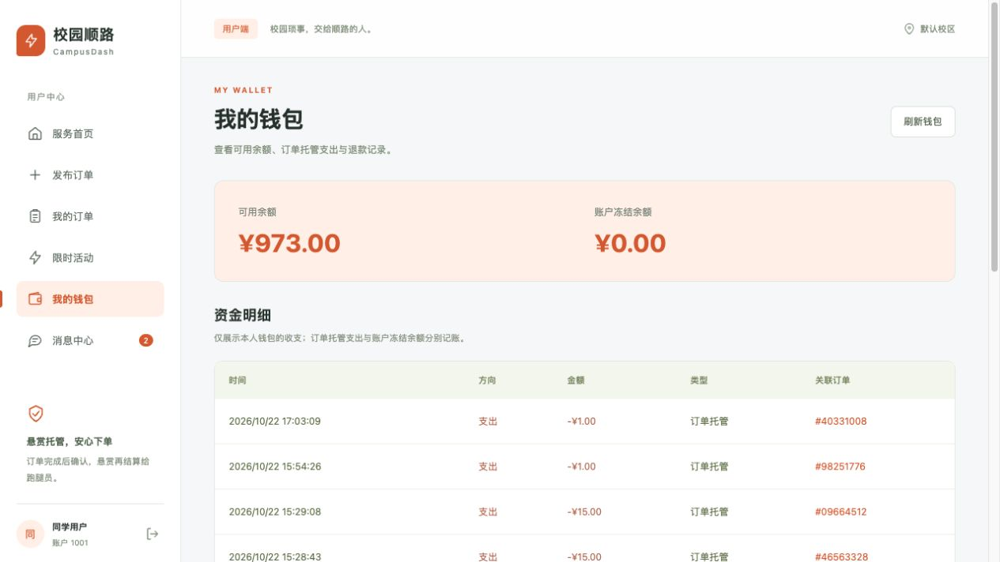

# 系统自查与修复记录

日期：2026-10-22。范围：三端路由、角色权限、订单与资金展示、分页并发、活动恢复、会话、实时更新、消息及输入验证。

## 已复现和修复

| 问题 | 影响 | 修复与验证 |
| --- | --- | --- |
| 特殊 URL 可绕过按原始 URI 执行的角色限制 | 不具备该能力的角色仍能到达业务接口 | 改用 Spring 实际匹配的路由进行鉴权；单元测试和本地 HTTP 对三种替代地址复验，均拒绝 |
| 钱包按业务 user_id 查询复式账本 | 托管账户、平台账户配对分录混入个人收入与支出 | 仅查询 owner_type=USER 且账户归属为本人的分录；原始账本保留。H2 与真实订单流水复验 |
| 带查询参数的合法页面误显示接单大厅 | 用户钱包、订单等链接可能错页 | 统一拆分与规范路径，只保留支持的发布服务类型参数；测试包括跨角色与旧链接 |
| 分页、刷新、状态切换请求可能相互覆盖 | 重复加载、跳页、旧状态结果覆盖新筛选 | 引入串行分页控制器，刷新原子更新全部已加载页；卸载或换筛选后的旧响应不提交；失败页可重试 |
| 大厅搜索和悬赏排序只作用于已加载的前 20 条 | 较早发布的需求无法通过搜索找到，排序不代表校区整体 | 服务端在分页前按校区、状态、类型、关键词筛选并排序；LIKE 通配符转义；H2 验证较早记录和本地 HTTP 复验 |
| 活动请求只在发送成功后保存请求号 | 网络中断时无法恢复，超时后新请求覆盖旧请求 | 发送前保存请求号及完整内容；未知结果一直保留，禁止新请求替换，可继续查询或原号重试；支持旧版仅存请求号的记录 |
| 活动页加载失败也显示“暂无活动” | 服务异常被误认为空数据 | 分开加载中、加载失败和空状态，活动时间状态定期刷新 |
| 订单操作忽略业务结果中的 CONFLICT、ALREADY_DONE | 未完成的结算或退款可能被提示成功；重复仲裁可能被误报退款 | 后端冲突返回业务失败码；前端区分真实结果，仲裁需要选定方向后再次确认 |
| 详情刷新失败后仍留有可执行的旧按钮 | 转派或失去查看权限后显示失效信息 | 权限失效时清空缓存详情；更新失败期间收窄操作，进度读取失败单独提示与重试 |
| 损坏的缓存身份、缺失 token、身份校验异常 | 页面初始化崩溃或进入错误工作区 | 校验缓存完整性，账户经服务端验证后再展示，验证失败可重试或退出 |
| 部分会话过期只体现在业务码中，退出仅清理本地 | 会话未及时清理；旧 token 仍可使用 | 同时处理 HTTP 401 和 UNAUTHORIZED；退出调用服务端撤销 access token；旧请求不能注销新登录会话 |
| 网关 HTML 错误页与无限等待 | 显示原始 JSON 解析错误或长期转圈 | 统一可读网络错误，15 秒超时；普通发布结果未知时要求先核对订单再重新填写 |
| WebSocket 绑定固定 8080 端口，断开后可用状态延迟变化 | 更换部署端口或 HTTPS 后连接不成立，降级状态不准确 | 改为同源 /ws，开发代理开启 WS；立即降级、单连接与重连定时器清理 |
| 钱包流水与消息只取第一页，未读角标缺少清除操作 | 历史记录不可达，通知长时间保持未读 | 增加分页，消息返回已读状态，可全部标记已读，角标同步更新；读写都限制在本人账户 |
| 发布和仲裁参数校验不完整 | 空需求、非法金额或错误裁决方向进入业务层；部分错误变成 500 | 在资金操作之前验证，统一 INVALID_ARGUMENT；错误裁决方向不再默认支持跑腿；拒绝空、零或系统身份 ID |

## 验证记录

- 前端：`npm test`，14 个回归测试通过；`npm run build` 通过。
- 后端：`mvn -pl dash-presentation,dash-infrastructure -am test -DfailIfNoTests=false`，66 个测试通过，0 失败、0 跳过。
- 本地接口：替代 URL 的角色拒绝、非法发布不改变余额、错误仲裁方向、旧订单搜索、全局悬赏排序、个人账本归属、通知已读字段、注销旧 token 均实测通过。
- 新验收订单 `238950292140331008`，标题“自查回归：文件递送”：发布、接单、确认、取件、送达、结算通过，重复结算返回 `ALREADY_SETTLED`。个人流水为发布用户支出 100 分、跑腿员收入 95 分，平台配对分录不混入个人钱包。
- 浏览器：带查询参数的钱包地址正确规范化；钱包展示真实个人收支；“全部标为已读”后消息状态和侧栏角标同步更新。
- 本地服务已更新；未清库、重建表或删除历史流水。验收订单作为演示记录保留。

## 仍保留的产品与部署边界

1. 登录仍为演示账户选择。正式账号认证、持久化角色、跑腿入驻审核、真实地址与联系方式、充值提现等尚未建设。本次不把这些不存在的功能视为已完成。
2. 内部压测和运维接口沿用工程原有的本机／内网使用方式。生产配置仍须按后端部署说明屏蔽 `/api/internal/**`，并将演示身份登录替换为正式认证。
3. 普通发布接口尚无持久化请求幂等键。前端防重复点击，并在网络结果不确定时引导核对订单；这不等于覆盖所有跨设备和网络重试情况的服务端幂等保证。活动接口则使用原请求号恢复和重试。
4. 个人订单状态分类数量仍统计已加载记录，页面明确标注范围，可继续加载。大厅搜索已改成服务端全量筛选。列表采用 OFFSET 分页，超大数据与高频插入场景可继续升级为游标方案。
5. 本轮不是完整生产安全认证，也不保证软件不存在其他缺陷。验证覆盖本次修改和列出的流程；未对共享演示数据库运行会清理业务数据的整套集成测试。

