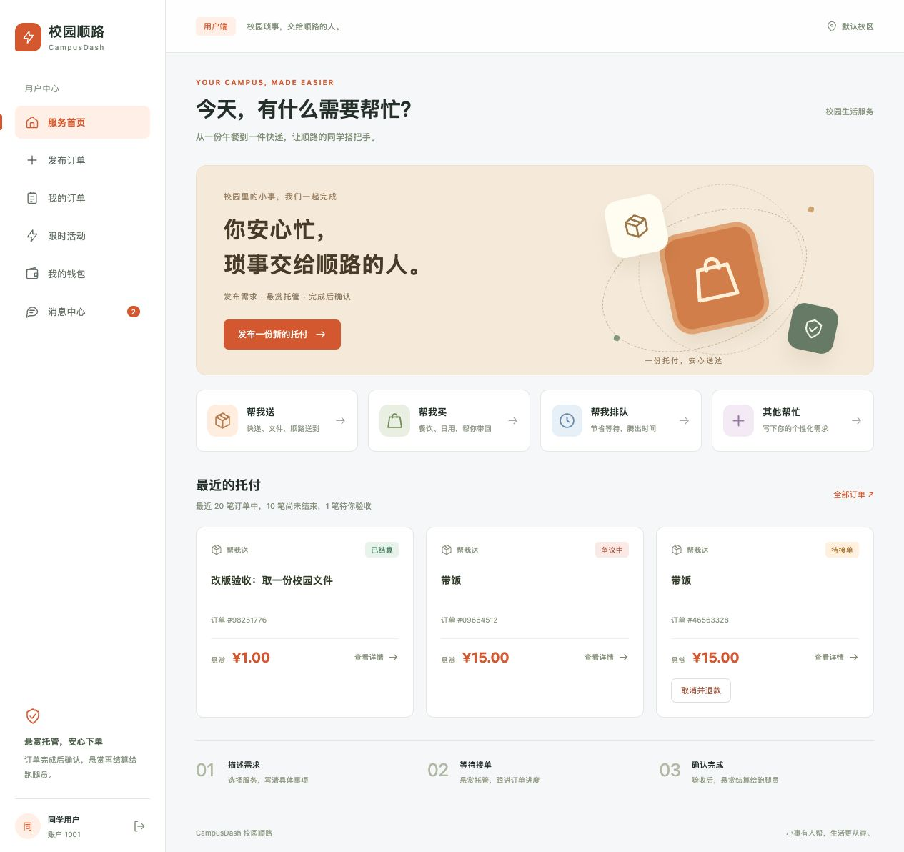
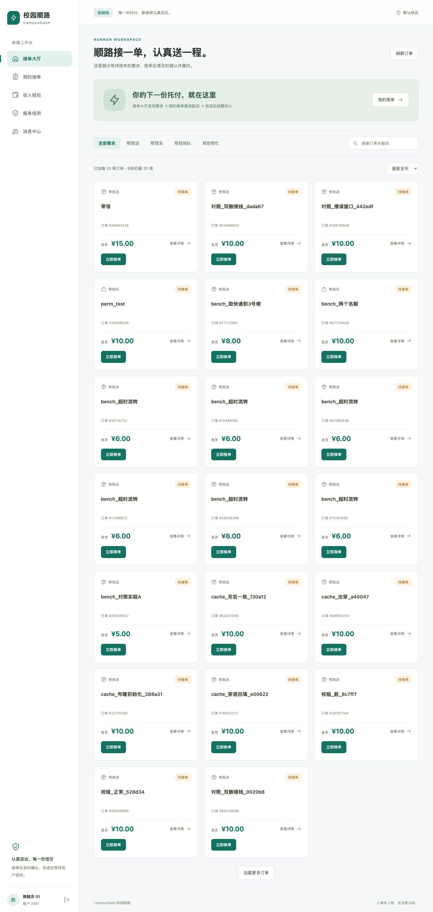
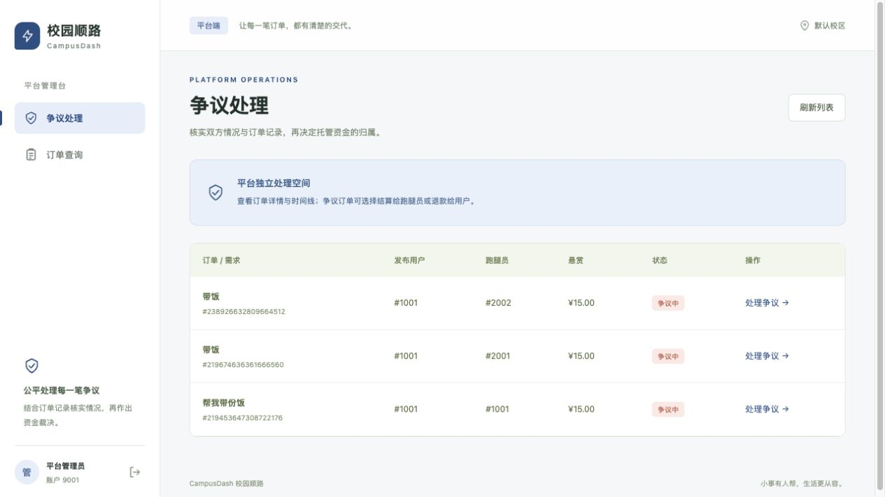
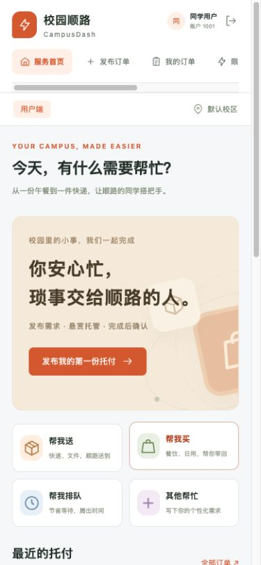

# 校园顺路：系统角色与体验整改方案

日期：2026-10-22

后续自查修复已补充在 [系统自查与修复记录](系统自查与修复记录.md)，以下实施快照保留首轮验收记录。

## 一、问题与目标

原系统把发布用户、跑腿员和仲裁员放进同一套导航。“我的任务”默认显示发布记录，跑腿员需要手动换到接单记录；平台账户甚至会收到抢单按钮。并发模拟通过临时登录其他账户执行，技术演示与日常业务操作混杂。页面还向普通用户展示数据库事务、消息队列、事件溯源等实现细节。

本次以三条业务主线重新组织系统：用户发布需求并验收；跑腿发现需求并履约；平台查看记录并处理争议。三个工作区使用统一视觉语言，以橙、青绿、深蓝区分角色。

## 二、信息架构与路由

| 角色 | 核心目标 | 页面与路由 |
| --- | --- | --- |
| 发布用户 | 发布与跟进自己的订单 | `/user/home`、`/user/publish`、`/user/orders`、`/user/activities`、`/user/wallet`、`/user/messages` |
| 跑腿员 | 接单、确认、取件、送达 | `/runner/hall`、`/runner/orders`、`/runner/wallet`、`/runner/credit`、`/runner/messages` |
| 平台管理员 | 查询订单与处理争议 | `/admin/disputes`、`/admin/orders` |

订单详情沿用 `/detail/:id`，由后端检查查看权限与可执行操作。跨工作区地址跳转到当前角色首页。旧路由根据当前角色迁移，避免历史链接失效。

## 三、权限与订单边界

| 能力 | 发布用户 | 跑腿员 | 平台管理员 |
| --- | --- | --- | --- |
| 发布订单、参与发布活动 | 是 | 否 | 否 |
| 浏览接单大厅 | 否 | 仅待接单订单 | 通过订单查询查看 |
| 接单、确认接单、取件、送达 | 否 | 是；履约操作校验当前跑腿员 | 否 |
| 查看个人订单 | 自己发布的 | 当前归属本人及本人完成的 | 使用平台订单查询 |
| 取消、确认完成 | 仅自己的且状态允许 | 否 | 否 |
| 发起争议 | 自己参与且状态允许 | 自己参与且状态允许 | 否 |
| 争议裁决 | 否 | 否 | 仅争议状态 |
| 钱包、消息 | 本人 | 本人 | 不出现在平台工作区 |
| 信用 | 不出现在用户工作区 | 本人信用、校区排行 | 不出现在平台工作区 |

权限以服务端 `WorkspaceRolePolicy` 为准。`WorkspaceAccess` 在认证之后拦截跨角色接口，`ErrandActionResolver` 计算操作集合，原用例中的订单归属和状态校验继续生效。详情和时间线限制为发布本人、当前履约跑腿员、管理员；跑腿员可以浏览大厅中的待接单需求。

“我的接单”查询改为当前 `grabber_id`，避免超时转派给他人的订单仍混入个人履约列表。历史抢单轮次记录保留在数据库中。不会删除既有订单或流水，也不迁移资金数据。

## 四、页面与交互整改

1. 登录页先选工作区，再选演示账户。取消业务页面中的即时身份切换下拉框，退出后再进入另一工作区。
2. 用户首页提供四类服务入口，携带类型进入发布表单；最近订单展示当前加载数据的真实数量。
3. 发布页面按服务、需求、悬赏三步组织。需求仍写入现有标题字段（64 字限制），取送地点和交接方式在描述中填写；未伪造后端不支持的地址、距离、预计时间等字段。
4. 跑腿大厅提供服务分类、关键词搜索、悬赏排序、分页和明确空状态。移除直接抢占真实订单的并发模拟入口；压测继续通过原有 bench 工具执行。
5. 我的订单与我的接单分开查询，按进行中／待验收／完成／争议／关闭退款筛选。分类与排序作用于当前加载结果，页面明确统计范围。
6. 平台独立展示争议表格和按状态查询的订单表格；详情只提供适用的仲裁操作。
7. 钱包、信用、通知统一视觉和文案，加载失败展示错误，不再全部吞掉异常。普通业务页面移除 MQ、Lua、数据库事务等工程说明。
8. 取消订单、确认完成、发起争议增加页面内确认；发布和仲裁提交期间禁用重复操作。
9. 手机尺寸下切换为顶部横向导航、单列订单和表单，平台表格支持容器内横向滚动。
10. 修复退出时旧 WebSocket 仍自动重连的问题；旧请求的 401 不再注销新会话；跨标签页变更身份触发同步重载。

## 五、实施与验收记录

已按“角色路由隔离 → 页面重构 → 后端角色与订单归属约束 → 编译和实测”完成。

- 前端：`npm run build`，TypeScript 与 Vite 生产构建通过。
- 后端：`mvn -pl dash-presentation,dash-infrastructure -am test -DfailIfNoTests=false`，60 个单元／组件测试通过，0 失败、0 跳过；包含角色能力、操作按钮和 H2 下的接单归属与分页回归测试。
- 本地 HTTP 验收：三角色登录与 `/api/auth/me` 一致；10 类跨工作区请求返回 `FORBIDDEN`。
- 本地订单验收：演示用户 1001 发布 1 元验收订单，跑腿 2002 完成接单、确认、取件、送达，用户确认后状态为 `SETTLED`。订单号 `238933001298251776`，标题“改版验收：取一份校园文件”。该记录保留在演示库中。
- 归属验收：其他跑腿不能确认、查看该履约订单或其时间线；两位跑腿的个人列表均只返回本人归属订单。
- 浏览器：检查用户首页、服务预选发布表单、跑腿大厅、平台争议列表与详情；用户直接打开跑腿 URL 会返回用户首页；检查 390 × 844 移动布局。
- 本地后端已更新，使用本机现有 MQ 端口 `127.0.0.1:18081`；未重新初始化数据库或中间件。

## 六、当前边界与后续建设

目前仍沿用项目原有演示身份登录。默认发布账户为配置 `dash.auth.publisher-ids: "1001"`，管理员为 `dash.auth.arbitrator-id: 9001`；其他演示或压测账户延续跑腿角色。角色由服务器判定，修改浏览器的角色值不能绕过 API 权限。

若要正式上线，后续应以持久化账户角色与跑腿入驻审核替代演示账户注册表，并独立建设真实登录、地址和联系方式、充值提现、争议材料提交与审计后台。本次未把这些尚不存在的业务包装为已上线功能。

## 七、界面预览

